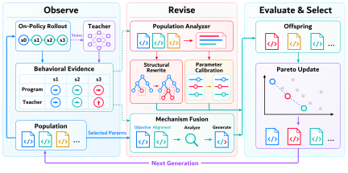

<div align="center">

# Teacher-Aware Evolution

### Heuristic Programs from Learned Optimization Policies

**NeurIPS 2026**

[](https://openreview.net/forum?id=dXWka7F0Ie)
[](pyproject.toml)
[](LICENSE)

**Learn from neural policies during search. Deploy executable heuristics.**

[Quick Start](#quick-start) · [Run Evolution](#run-evolution) · [Data & Teachers](docs/assets.md) · [Algorithm](docs/algorithm.md) · [Citation](#license-and-citation)

</div>

<br>



## Overview

Code for **Teacher-Aware Evolution of Heuristic Programs from Learned Optimization Policies**.

Teacher-Aware Evolution searches for executable heuristics using feedback from
learned optimization policies. Structural rewrite, parameter calibration, and
mechanism-level fusion produce new programs. Learned teachers are used during
search, not deployment. The implementation supports JSSP, TSP, CVRP, and Max-Cut.

| Structural Rewrite · `s` | Parameter Calibration · `p` | Mechanism-Level Fusion · `m` |
| :--- | :--- | :--- |
| Revise decision structure. | Refine numerical parameters. | Analyze a selected pair and combine its mechanisms. |

## Quick Start

### 1. Install

Use Python 3.10 or newer. Install a CUDA-compatible PyTorch build for GPU teachers.

```bash
git clone https://github.com/Minkow/Teacher-Aware-Evolution.git
cd Teacher-Aware-Evolution

python -m venv .venv
source .venv/bin/activate
python -m pip install -e .
```

### 2. Preview a Run

Inspect the complete configuration without sending any request:

```bash
python scripts/run.py --task tsp50 --seed 0 --dry-run
```

## Run Evolution

Prepare the [data and teacher](docs/assets.md), then supply five initial programs
through `--seed-programs`:

```bash
export OPENAI_API_KEY='your-key'
export OPENAI_BASE_URL='https://api.openai.com/v1'
python scripts/run.py --task tsp50 --seed 0 \
  --seed-programs initial-programs.json \
  --data data/tsp50/train.pkl \
  --teacher-root external/LEHD/single_objective \
  --checkpoint checkpoints/tsp/checkpoint-150.pt \
  --output runs/tsp50/s0
```

| Problem | Task / Paper Presets | Size Controls |
| :--- | :--- | :--- |
| JSSP | `jssp`, `jssp10`, `jssp15`, `jssp20` | `--jobs`, `--machines` |
| TSP | `tsp`, `tsp50` | `--problem-size` |
| CVRP | `cvrp`, `cvrp50` | `--problem-size`, `--capacity` |
| Max-Cut | `maxcut` | `--nodes`, `--max-steps` |

<details>
<summary><strong>Model, concurrency, and run configuration</strong></summary>

`--train-count`, CVRP `--capacity`, and Max-Cut `--max-steps` are configurable.
CVRP uses the capacities stored in the dataset unless `--capacity` is supplied.
Teacher checkpoints must support the requested dimensions.
Instance rollout concurrency is controlled by `--rollout-workers`; child
generation is controlled independently by `--workers`.
All worker counts, including one, use the same instance-evaluation and teacher
analysis pipeline.
Offspring requests use threads to share the evaluation budget; instance rollouts
use worker processes.
Rollout deadlines are enforced by the parent process: timed-out workers are
terminated and reaped, and their slots are replaced for subsequent evaluations.
`--model` defaults to `gpt-5.4`; configure it explicitly when using a different
provider/model. Run seeds separately using `--seed` and distinct output paths.
The launcher never starts a new run inside a nonempty output directory.

## Project Layout

| Path | Contents |
| --- | --- |
| `scripts/run.py` | Portable experiment launcher |
| `src/tae/engine/` | Evolution operators, selection and LLM clients; adapted from EoH |
| `src/tae/analysis/` | Population diagnosis and structural memory |
| `src/tae/tasks/` | JSSP and Max-Cut state, simulator and heuristic interfaces |
| `src/tae/teachers/` | LEHD adapter; task-specific JSSP/Max-Cut adapters reside with their interfaces |
| `src/tae/runners/` | Training and standalone evaluation entry points |

Generated programs, historical initialization banks, and experimental outputs are
not bundled. Supply five initial programs through `--seed-programs`.

## Evaluation

Standalone entry points are available as Python modules:

```bash
python -m tae.runners.evaluate_jssp_construct_eoh --help
python -m tae.runners.evaluate_tsp_construct_eoh --help
python -m tae.runners.evaluate_cvrp_construct_eoh --help
python -m tae.runners.evaluate_maxcut_bench_eoh --help
```

Select programs using training performance before evaluating held-out instances.
Keep the dataset, step budget, and worker configuration fixed when comparing methods.

## Maintenance and feedback

AI tools assisted with repository organization, refactoring, and documentation.
We review these changes, but errors may remain.
If you encounter a bug or a discrepancy with the paper, please
[open an issue](https://github.com/Minkow/Teacher-Aware-Evolution/issues)
or contact [Minyu Chen](https://minkow.me).
Including the command, environment, and a minimal example will help us investigate.
Please remove API keys and other private information from logs before sharing them.

## License and citation

> **Teacher-Aware Evolution of Heuristic Programs from Learned Optimization Policies**  
> Minyu Chen, Song Qin, Ling-I Wu, Jianxin Xue, and Guoqiang Li.  
> NeurIPS, 2026. [Paper on OpenReview](https://openreview.net/forum?id=dXWka7F0Ie)

Original contributions are distributed under the MIT license. Third-party code
retains its notices; data and pretrained weights retain their original licenses.
See [LICENSE](LICENSE) and [CITATION.cff](CITATION.cff).

Generated Python is executable code. Run evolution in an isolated, unprivileged
environment without sensitive files. AST validation and timeouts are not a
security sandbox.

